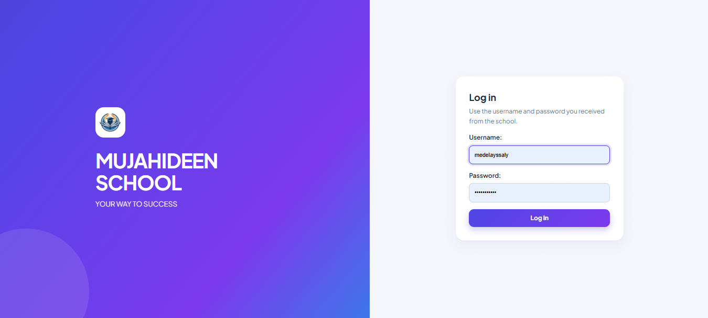
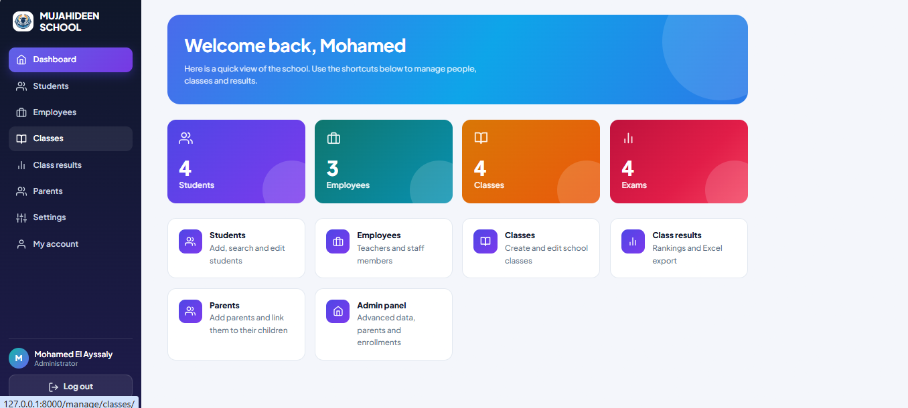
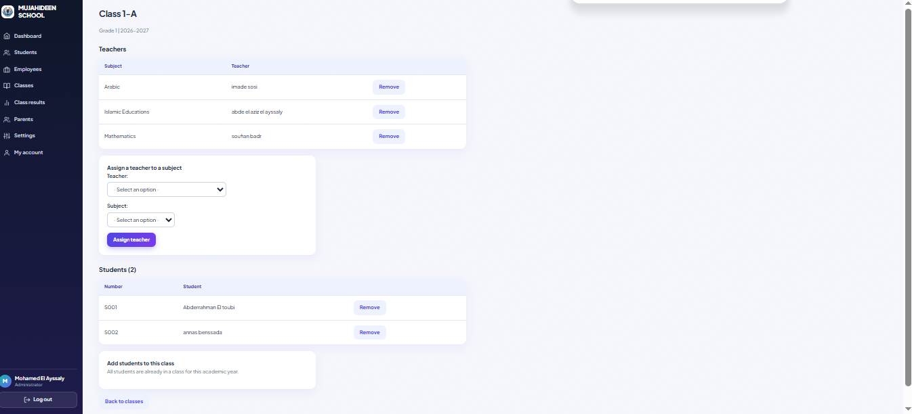
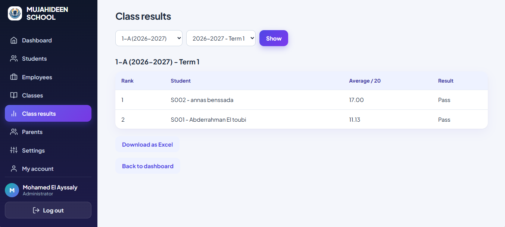
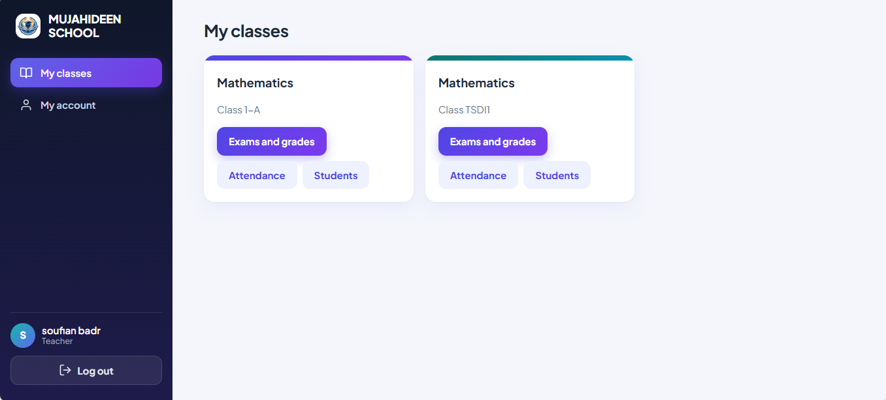
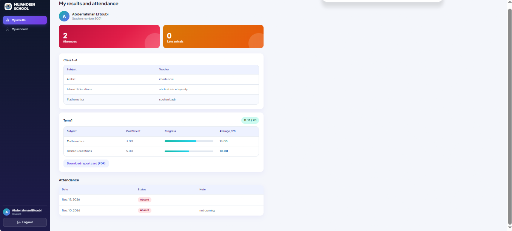
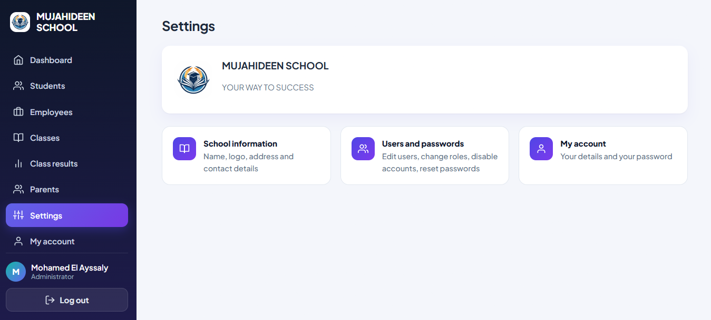

# School Management System

A Django web application to manage a school: students, employees, classes,
exams, grades, results, attendance and report cards, with separate access for
the direction, teachers, students and parents.

## Features

- Role-based access: direction, teacher, student and parent
- Direction pages: students, employees, parents, classes (list, search, add, edit)
- Class page: add students to a class, assign teachers to subjects
- Teachers: their classes, students with parents' contacts, attendance, exams and grade entry
- Weighted subject and term averages, class ranking and pass or fail
- Attendance per student and per day
- PDF report card for students, Excel export of class results
- Parents see only their own children
- Settings: school name, logo and details, user management, password change
- Responsive design with a gradient dashboard

## Screenshots

## Tech stack

Python, Django, SQLite, HTML, CSS, JavaScript, ReportLab, openpyxl, Git

## Run it locally

    git clone https://github.com/mohamedelayssaly/school-management.git
    cd school-management
    python -m venv venv
    venv\Scripts\activate
    pip install -r requirements.txt
    python manage.py migrate
    python manage.py createsuperuser
    python manage.py runserver

Open http://127.0.0.1:8000/admin, log in, create a user with the role
Direction, then create an academic year, terms, a level, classes and subjects.
Add students, teachers and parents from the Direction pages.

## Project structure

- accounts: login, roles, dashboards, results pages
- academics: academic years, terms, levels, classes, subjects
- people: students, employees, parents, enrollments, teaching assignments
- exams: exams, grades, averages, PDF report card
- attendance: daily attendance
- school_admin: management pages for the direction
- school_settings: school information, users and passwords

## What I learned

- Designing a relational database for a real domain
- Role-based access control with Django mixins and filtered queries
- Building forms, generic class-based views and templates

- Generating PDF and Excel files
- Working with Git and GitHub

## Next improvements

- Automated tests
- REST API with Django REST Framework
- Deployment with PostgreSQL

## Author

Mohamed El Ayssaly: https://github.com/mohamedelayssaly